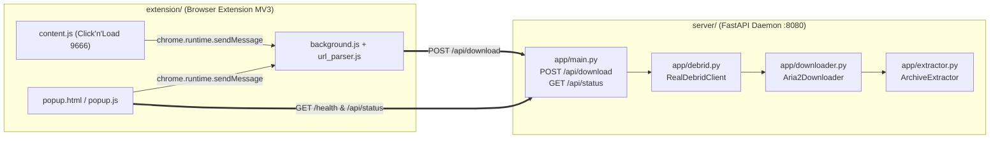

# Debrid Hub (`debrid-hub`) - AI Agent Collaboration & Repository Guide

This document is the **single source of truth** for AI agents working on `debrid-hub`. Do not guess folder paths, module boundaries, API routes, or JSON field names—follow the exact architectural contracts defined below.

---

## 1. Project Overview & Environment

- **Domain**: Unified lightweight Real-Debrid server daemon (`server/`) and Manifest V3 browser extension (`extension/`).
- **GitHub Repository**: `progiwell/debrid-hub`
- **Backend Runtime & Environment**: Python 3.11+ (local virtualenv located at `venv/`).
- **Frontend & Build Architecture**:
  - Both `extension/` (`extension/src/*.ts`, `extension/src/styles.css`) and `server/` Web Dashboard (`server/app/static/src/*.ts`, `server/app/static/src/styles.css`) standardize on zero-framework **Vanilla TypeScript** (`esbuild`) + **Tailwind CSS** (`@tailwindcss/cli`) — zero React/Preact/Lit runtime footprint.
  - Compiled `.js` / `.css` bundles are **gitignored** and automatically compiled on demand via `npm run build` (`scripts/build_frontend.mjs`), `extension/build.py`, GitHub Actions CI (`tests.yml`), and the multi-stage `server/Dockerfile` (`node:22-alpine AS ui-builder` → `python:3.11-alpine`).
- **Secrets Management**: Configuration is loaded from environment variables via `server/app/config.py` and `.env`. Never commit API keys or credentials.
- **Worktree Directory**: `scratch/issue<NUMBER>`
  - Worktree creation: `git worktree add scratch/issue<NUMBER> -b <type>/issue-<NUMBER>-<slug>`

---

## 2. Canonical Directory Tree (Strict Folder Boundaries)

All code **must** reside in the two top-level domain folders (`server/` and `extension/`) plus root build/config manifests (`package.json`, `package-lock.json`, `tsconfig.json`, `scripts/`). Never place Python application files or browser extension files in the repository root.

```text
debrid-hub/
├── AGENTS.md                        # Authoritative AI Agent architecture & operating guide
├── README.md                        # Project overview & quickstart
├── .env.template                    # Environment variable template
├── .dockerignore                    # Docker build context exclusions (repo root)
├── package.json                     # Frontend scripts (`typecheck`, `build`, `build:ext`, `build:server`, `watch`)
├── package-lock.json                # Locked Node dev dependencies (`typescript`, `esbuild`, `tailwindcss`, `@tailwindcss/cli`)
├── tsconfig.json                    # Strict TypeScript compiler configuration
├── scripts/
│   └── build_frontend.mjs           # Shared `esbuild` + `@tailwindcss/cli` bundler
├── .github/
│   └── workflows/
│       ├── docker-publish.yml       # Multi-arch GHCR Docker image build & publish
│       ├── gemini_pr_reviewer.yml   # Automated Gemini PR review against linked GitHub Issue
│       └── tests.yml                # Frontend build/tests & Pytest CI runner
├── server/                          # [FOLDER 1] Lean Server Docker Backend (Python FastAPI + Aria2c + Unrar)
│   ├── Dockerfile                   # Multi-stage Alpine container (node:22-alpine UI builder → python:3.11-alpine runtime)
│   ├── docker-compose.yml           # Docker Compose specification
│   ├── docker-entrypoint.sh         # Container entrypoint with graceful SIGTERM handling
│   ├── deploy.sh                    # Graceful deployment & update script
│   ├── README.md                    # Server deployment & API usage guide (Issue #5)
│   ├── requirements.txt             # Production Python dependencies (fastapi, uvicorn, httpx, pydantic)
│   ├── requirements-dev.txt         # Test/lint dependencies (pytest, pytest-asyncio, pytest-cov, ruff)
│   ├── app/                         # Python package root (import as `from app.<module> import ...`)
│   │   ├── __init__.py              # Package version (`__version__`)
│   │   ├── config.py                # `Settings` dataclass & `get_settings()` env loader
│   │   ├── db.py                    # `JobStore` SQLite persistence & crash recovery
│   │   ├── debrid/                  # Multi-Debrid provider package
│   │   │   ├── __init__.py          # `get_debrid_provider()` factory & `SUPPORTED_PROVIDERS`
│   │   │   ├── base.py              # `BaseDebridProvider`, `classify_url()`, `is_info_hash()`
│   │   │   └── realdebrid.py        # `RealDebridProvider` / `RealDebridClient`
│   │   ├── debrid.py                # Backwards-compatibility re-export module for `app.debrid`
│   │   ├── dependencies.py          # FastAPI auth & settings dependency providers
│   │   ├── downloader.py            # `Aria2Downloader` subprocess wrapper (Issue #2)
│   │   ├── events.py                # `JobEventBus` in-memory SSE pub/sub
│   │   ├── extractor.py             # `ArchiveExtractor` unrar/7z & split-volume cleanup (Issue #3)
│   │   ├── main.py                  # FastAPI app (`app`), `JOBS` store, background orchestrator, REST endpoints (Issue #4)
│   │   ├── qbittorrent.py           # qBittorrent Web API v2 emulation layer (`/api/v2/*`)
│   │   ├── schemas.py               # Pydantic models: `LinkType`, `JobStatus`, `DownloadRequest`, `DownloadJob`, `DownloadResponse`
│   │   ├── torrent_utils.py         # Magnet URI & bencoded `.torrent` metadata parser
│   │   ├── static/                  # Dashboard static sources (`src/dashboard.ts`, `src/styles.css`); compiled assets gitignored
│   │   │   └── src/
│   │   └── templates/
│   │       └── settings.html        # In-browser Web Dashboard & Settings UI
│   └── tests/                       # Pytest unit & integration suite for server/
│       ├── __init__.py
│       ├── test_config.py           # Tests for `app/config.py`
│       ├── test_db.py               # Tests for `app/db.py`
│       ├── test_debrid.py           # Tests for `app/debrid` (Issue #1)
│       ├── test_deploy.py           # Tests for `deploy.sh`, `docker-entrypoint.sh`, & Compose config
│       ├── test_downloader.py       # Tests for `app/downloader.py` (Issue #2)
│       ├── test_extractor.py        # Tests for `app/extractor.py` (Issue #3)
│       ├── test_main.py             # Tests for `app/main.py` endpoints & pipeline (Issue #4)
│       └── test_qbittorrent.py      # Tests for `app/qbittorrent.py` & `app/torrent_utils.py`
├── extension/                       # [FOLDER 2] Unified Browser Extension (Chrome/Firefox Manifest V3)
│   ├── README.md                    # Extension build, installation & usage guide
│   ├── manifest.json                # Canonical Chrome Manifest V3 config (`service_worker`)
│   ├── build.py                     # Frontend compiler, Firefox asset sync, manifest validator & packaging helper
│   ├── firefox/                     # Dedicated Firefox MV3 manifest (`scripts`) & synced copied assets
│   ├── src/                         # TypeScript & Tailwind CSS sources (compiled bundles gitignored)
│   │   ├── types.ts                 # Shared REST API, job, settings & message contracts
│   │   ├── url_parser.ts            # URL classifier, file-page detector & multi-link text extractor
│   │   ├── permissions.ts           # Chrome/Firefox runtime host permission helpers
│   │   ├── storage.ts               # Server profile storage, migration & identity helpers
│   │   ├── queue_ui.ts              # Queue sorting, pill filtering & job card rendering
│   │   ├── background.ts            # Service worker: context menu & POST /api/download dispatcher
│   │   ├── content.ts               # Click'n'Load (127.0.0.1:9666) form/click interceptor & AES decryptor
│   │   ├── popup.ts                 # Popup controller: 3-tab navigation, profiles & SSE queue monitor
│   │   └── styles.css               # Tailwind CSS v4 entrypoint & semantic theme tokens
│   ├── popup.html                   # Extension popup UI: Jobs, Add & Settings tabs
│   └── tests/                       # Node.js unit test suite (`test_url_parser.js`, `test_popup_filter.js`)
│       ├── test_url_parser.js
│       └── test_popup_filter.js
└── scratch/                         # Ephemeral isolated git worktrees (`scratch/issue<ID>`) — gitignored
```

---

## 3. High-Level System Architecture & Data Flow



### End-to-End Execution Pipeline (`server/`)
1. **Ingest (`app/main.py`)**: `POST /api/download` validates optional `API_AUTH_KEY`, creates a `DownloadJob` (`status="queued"`) in `JOBS[job_id]`, schedules `process_download_job` via FastAPI `BackgroundTasks`, and returns `202 Accepted`.
2. **Resolve (`app/debrid.py`)**: Job transitions to `status="resolving_debrid"`. `RealDebridClient.resolve_to_direct_links(url)` either:
   - Calls `POST /unrestrict/link` for `LinkType.HOSTER`, or
   - Calls `POST /torrents/addMagnet` $\to$ `POST /torrents/selectFiles/{id}` (`files="all"`) $\to$ polls `GET /torrents/info/{id}` until `status == "downloaded"` $\to$ unrestricts each link in `info["links"]` into direct CDN download URLs.
3. **Download (`app/downloader.py`)**: Job transitions to `status="downloading"`. `Aria2Downloader.download(cdn_url, output_dir)` runs `aria2c` (`-x 16 -s 16 --continue=true`) asynchronously via `asyncio.create_subprocess_exec` and writes files to `/downloads` (or `/downloads/<subfolder>`).
4. **Extract & Clean (`app/extractor.py`)**: If `settings.auto_extract` is `True` and any downloaded file satisfies `ArchiveExtractor.is_primary_rar(path)` (`.rar` or `.part01.rar` / `.part1.rar`), job transitions to `status="extracting"`. `ArchiveExtractor.extract_and_cleanup` runs `unrar x -o+ -y` and deletes all related split archive parts (`find_related_volumes`) only on exit code `0`.
5. **Complete (`app/main.py`)**: Job transitions to `status="completed"` (or `status="failed"` with `job.error` populated on any unhandled exception).

---

## 4. Cross-Component Contracts (Do Not Deviate)

### 4.1 REST API Contract (`server/app/main.py` $\leftrightarrow$ `extension/`)

| Method & Route | Request Headers / Body | Response Status & Schema |
| :--- | :--- | :--- |
| `GET /` / `/settings` / `/dashboard` | None | `200 OK` (`text/html`) $\to$ Web Dashboard & Settings UI |
| `GET /health` | None | `200 OK` $\to$ `{"status": "ok", "version": "0.1.0"}` |
| `GET /api/settings` | Optional Header: `X-API-Key: <key>` | `200 OK` $\to$ `SettingsResponse` (API key masked) |
| `PUT /api/settings` | Optional Header: `X-API-Key: <key>`<br/>JSON Body (`SettingsUpdateRequest`) | `200 OK` $\to$ `SettingsResponse` |
| `POST /api/settings/test-debrid` | Optional Header: `X-API-Key: <key>`<br/>JSON Body (`TestDebridRequest`, optional) | `200 OK` $\to$ `TestDebridResponse` |
| `POST /api/download` | Optional Header: `X-API-Key: <key>`<br/>JSON Body (`DownloadRequest`):<br/>`{"url": "magnet:?...", "apiKey": "optional_key", "subfolder": "optional_dir", "category": "optional_cat", "source": "optional_src", "client_id": "optional_uuid", "client_name": "optional_name"}` | `202 Accepted` (`DownloadResponse`):<br/>`{"job_id": "<uuid>", "status": "queued", "link_type": "magnet"\|"hoster", "message": "Download job queued"}`<br/>*(Returns `401` if `API_AUTH_KEY` is configured and key mismatches)* |
| `POST /api/upload/torrent` | Optional Header: `X-API-Key: <key>`<br/>Multipart Form: `file` (.torrent), `apiKey` (optional), `subfolder` (optional) | `202 Accepted` (`DownloadResponse`):<br/>`{"job_id": "<uuid>", "status": "queued", "link_type": "torrent", "message": "Torrent 'name' queued for download"}` |
| `GET /api/status/stream` | Optional Header: `X-API-Key: <key>` or Query: `?apiKey=<key>` | `200 OK` (`text/event-stream`) $\to$ SSE events (`init`, `job_created`, `job_update`, `job_deleted`, `jobs_cleared`) |
| `GET /api/status` | Optional Header: `X-API-Key: <key>`<br/>Optional Query: `?status=...&limit=100&offset=0` | `200 OK` $\to$ `List[DownloadJob]` |
| `GET /api/status/{job_id}` | Optional Header: `X-API-Key: <key>` | `200 OK` $\to$ `DownloadJob` *(or `404 Not Found`)* |
| `POST /api/status/{job_id}/retry` | Optional Header: `X-API-Key: <key>` | `202 Accepted` $\to$ `DownloadJob` *(or `404` / `400`)* |
| `DELETE /api/status/{job_id}` | Optional Header: `X-API-Key: <key>` | `200 OK` $\to$ `{"message": "Job deleted", "job_id": "<uuid>"}` |
| `DELETE /api/status` | Optional Header: `X-API-Key: <key>`<br/>Optional Query: `?status=completed\|failed` | `200 OK` $\to$ `{"deleted": <n>, "remaining": <n>}` |
| `DELETE /api/status/all` | Optional Header: `X-API-Key: <key>`<br/>Required Query: `?confirm=true` | `200 OK` $\to$ `{"message": "All jobs cleared", "deleted": <n>, "remaining": 0}` |
| `POST /api/v2/auth/login` | Form: `username`, `password` | `200 OK` $\to$ `"Ok."` (Sets `SID` session cookie) |
| `GET /api/v2/app/version` | None | `200 OK` $\to$ `"v4.5.2"` |
| `GET /api/v2/torrents/info` | Optional Query: `?filter=...&category=...&hashes=...` | `200 OK` $\to$ `List[qBittorrentTorrent]` |
| `POST /api/v2/torrents/add` | Form: `urls`, `torrents` (.torrent file), `savepath`, `category`, `tags` | `200 OK` $\to$ `"Ok."` |
| `POST /api/v2/torrents/delete` | Form: `hashes=<hash>\|<hash>`, `deleteFiles=true\|false` | `200 OK` $\to$ `"Ok."` |

### 4.2 Enum Values (`server/app/schemas.py`)
- `LinkType`: `"magnet"`, `"hoster"`, `"torrent"`
- `JobStatus`: `"queued"`, `"resolving_debrid"`, `"downloading"`, `"extracting"`, `"completed"`, `"failed"`

### 4.3 Browser Extension Storage & Messaging Contract (`extension/`)
- **`chrome.storage.local` Keys**:
  - `endpoints` (`Array<{ id: string, name: string, url: string, apiKey: string }>`, saved server profiles)
  - `activeEndpointId` (`string`, ID of the currently selected server profile)
  - `serverEndpoint` (`string`, active profile URL e.g. `"http://100.64.0.10:38415"`, synced with `nasEndpoint` for backward compatibility and stripped of trailing slash)
  - `apiKey` (`string`, active profile auth secret synced for backward compatibility if `API_AUTH_KEY` protection is enabled)
  - `enableNotifications` (`boolean`, optional toggle for desktop completion alerts, default `true`)
  - `notifiedJobIds` (`string[]`, internal list of job IDs already alerted for completion)
  - `clientId` (`string`, persistent UUID uniquely identifying this browser installation)
  - `clientName` (`string`, friendly browser/device label shown on the Server Dashboard, customizable in Settings)
  - `queueScope` (`"browser" | "all"`, defaults to `"browser"` so extension jobs, toolbar badge, and notifications scope to this browser)
- **Internal Runtime Message (`content.js` / `popup.js` $\to$ `background.js`)**:
  - Payload: `{ type: "QUEUE_URLS", urls: ["https://...", "magnet:?..."], subfolder?: "...", source?: "paste"|"click_n_load" }`
    - Response: `{ ok: true, queued: <count>, errors: [...] }`
  - Payload: `{ type: "UPDATE_BADGE" }`
    - Response: `{ ok: true }`

---

## 5. Issue-to-File Ownership Matrix

When implementing an issue, modify **only** the target files assigned to that issue:

| Issue | Component | Target Files to Modify |
| :--- | :--- | :--- |
| **#1** | Real-Debrid Client | `server/app/debrid.py`, `server/tests/test_debrid.py` |
| **#2** | Aria2c Downloader | `server/app/downloader.py`, `server/tests/test_downloader.py` |
| **#3** | Unrar Extractor | `server/app/extractor.py`, `server/tests/test_extractor.py` |
| **#4** | FastAPI Pipeline | `server/app/main.py`, `server/tests/test_main.py` |
| **#5** | Docker & Compose Ops | `server/Dockerfile`, `server/docker-compose.yml`, `server/README.md` |
| **#6** | Extension Popup Settings | `extension/popup.html`, `extension/popup.js`, `extension/manifest.json` |
| **#7** | Extension Background & Parser | `extension/url_parser.js`, `extension/background.js` |
| **#8** | Extension Click'n'Load | `extension/content.js`, `extension/background.js`, `extension/manifest.json` |
| **#9** | Extension Queue Monitor | `extension/popup.html`, `extension/popup.js`, `extension/README.md` |

---

## 6. Development Workflow & Quality Standards

- **Worktree Isolation**: Never edit directly on `main`. Create an isolated git worktree for each issue:
  ```bash
  git worktree add scratch/issue<ID> -b feat/issue-<ID>-<slug>
  ```
- **Python Test Execution (`server/`)**:
  Always verify tests before opening a PR using `PYTHONPATH=server` and the local virtualenv:
  ```bash
  PYTHONPATH=server venv/bin/pytest server/tests/ -x -v
  ```
- **Offline Unit Tests**: All external HTTP calls (`httpx`) and subprocess executions (`aria2c`, `unrar`) **must** be mocked in `server/tests/` so tests run deterministically offline in `<1s`.
- **PR Lifecycle**: Follow `/issue-lifecycle` (mark `--add-label "status: in-progress"`, include `Fixes #<ID>` in PR description) and `/ci-pr-reviewer` for automated code reviews.
- **Mandatory Automated PR Review Approval Gate**: Never merge a PR immediately after submission. Always wait for the `Gemini PR Reviewer` workflow to complete and verify `gh api repos/progiwell/debrid-hub/pulls/<PR_NUMBER>/reviews --jq '.[-1].state'` returns `APPROVED`. If the review is `CHANGES_REQUESTED`, fix all issues in the worktree, push updates, and ensure re-review approval before merging.
- **Post-Merge Cleanup**:
  ```bash
  git worktree remove scratch/issue<ID>
  git branch -d feat/issue-<ID>-<slug>
  git fetch --prune origin
  ```
